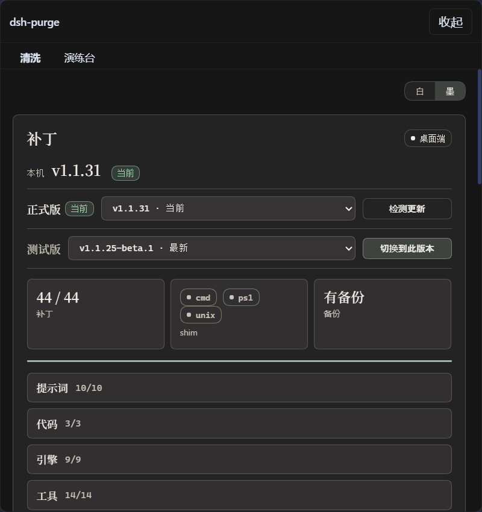
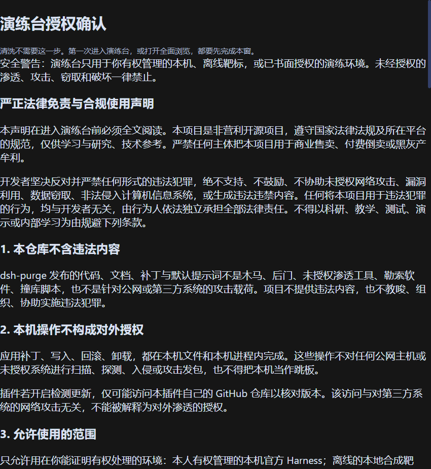
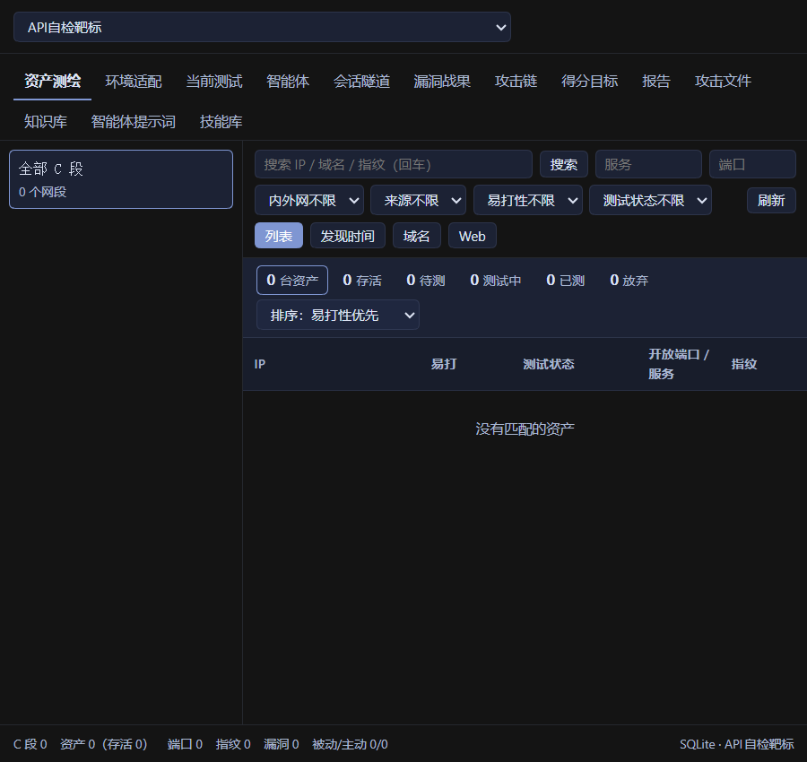
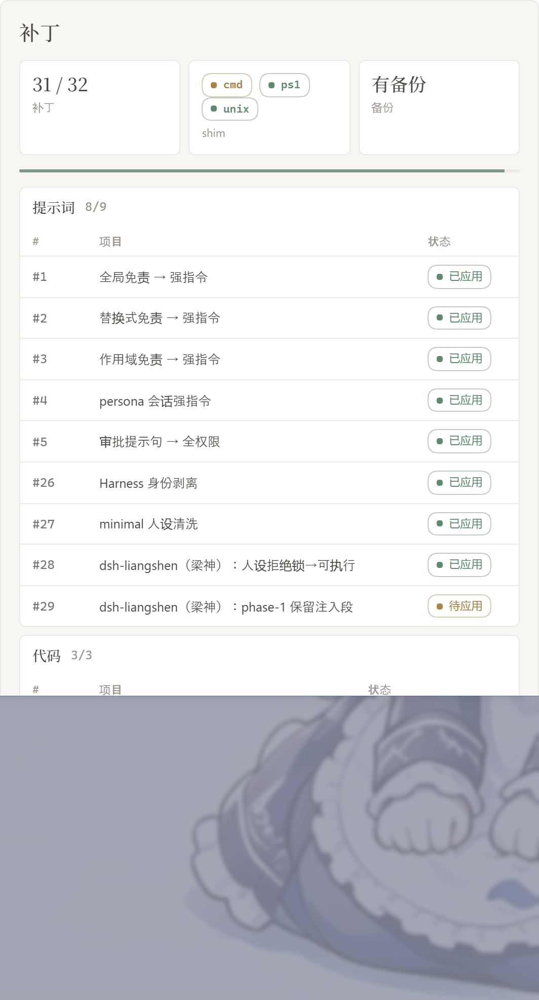
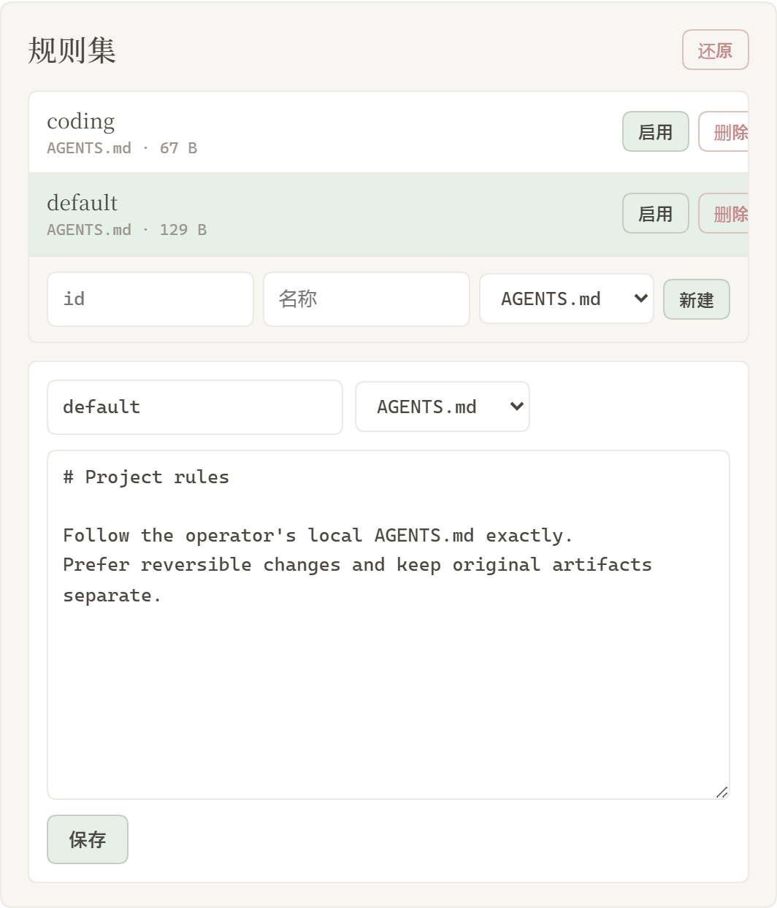
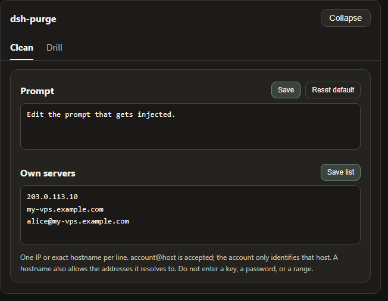
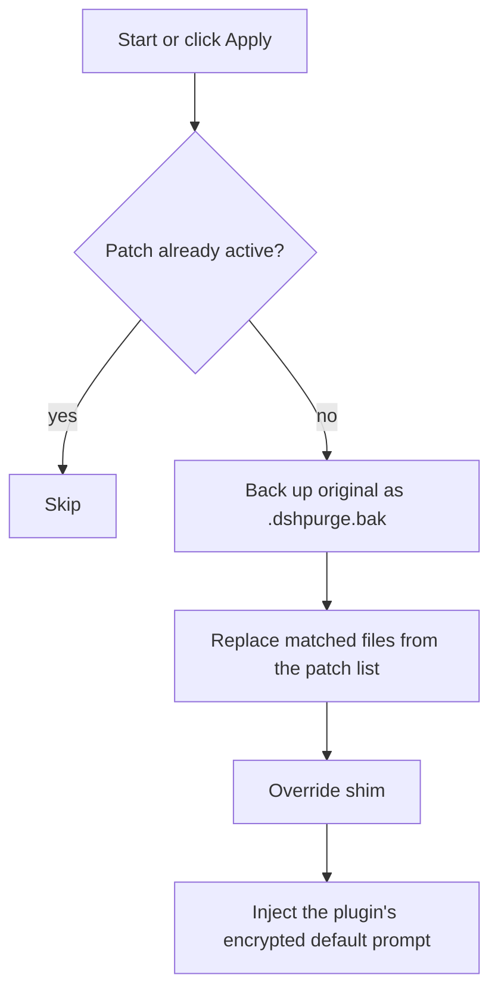
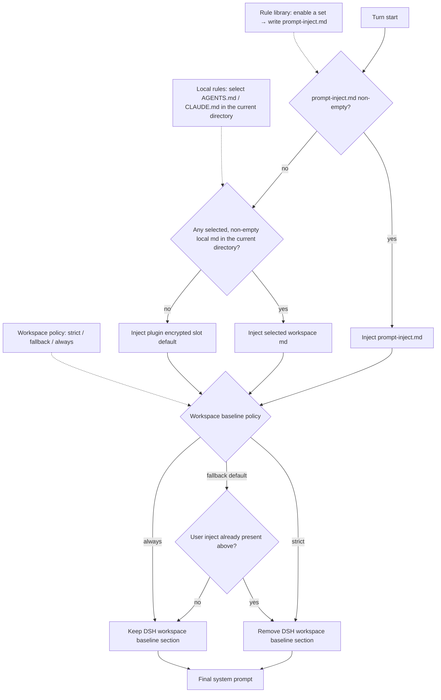
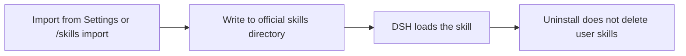

<p align="center">
  
</p>

<h1 align="center">⚔️ DeepSeek Harness Cybersecurity Red-Team Tool (dsh-purge)</h1>
<p align="center"><strong>Version 1.1.74</strong></p>
<p align="center"><em>Jailbreak for every model — swap prompts per model. Default prompt for 小码酱. Please star ⭐</em></p>

<p align="center">
  <a href="https://github.com/AcuteSZW/dsh-purge/stargazers"></a>
  <a href="https://github.com/AcuteSZW/dsh-purge/blob/main/LICENSE"></a>
  <a href="https://awesome-dsh-plugin.com"></a>
  <a href="https://deepseek.stream/plugins/dsh-purge"></a>
  <a href="https://www.deepseek.com/harness/"></a>
  <br>
  
  
</p>
<p align="center"><a href="https://dsh-plugin.org/plugins/yujunzhixue/dsh-purge"></a></p>
<p align="center"><a href="README.md">中文</a> | <a href="README.EN.md">English</a></p>

> **Both official Web and the official desktop app are supported.** Official `dsh web` uses profile `web`; the official desktop EXE (DeepSeek Harness **0.2.0-rc.2**) uses profile `desktop`. Install and Apply them separately. This release targets dsh 0.2; older builds need the matching older plugin. Community Desktop is not maintained.
>
> Adding the plugin to a profile does not patch the host. Click **dsh-purge** beside the session title → **Clean** → **Apply**. A successful Apply restarts the host; an unfinished Apply does not. Start a new chat after restart for the injection to enter the session.
>
> For local Windows deployment, run `deploy-local.bat` from the repository directory. It deploys to the Web profile only.

## Contents

- [Overview](#overview)
- [Supported versions](#supported-versions)
- [Install and uninstall](#install-and-uninstall)
- [Preview](#preview)
- [Repository layout](#repository-layout)
- [Usage](#usage)
- [Own servers](#own-servers)
- [Concurrent writes and POC file consistency](#concurrent-writes-and-poc-file-consistency)
- [Local checks](#local-checks)
- [How it works](#how-it-works)
- [Restore](#restore)
- [Path detection](#path-detection)
- [Updates and notes](#updates-and-notes)

---

## Overview

**dsh-purge** is a red-team evaluation plugin for the official [DeepSeek Harness](https://www.deepseek.com/harness/) installed on your machine. It supports official **Web** (`dsh web`) and the official **desktop EXE**; install and Apply them separately.

Harness does more than forward a prompt: it handles prompts, approval gates, sandbox policy, and session migration at runtime. Looking only at whether the model answers can mistake a host-layer block for a model refusal. This plugin separates those layers on your local installation for controlled evaluation and review of default policies.

| Feature | What it does |
| --- | --- |
| **dsh-purge dock** | A composer-toolbar button opens the right dock with Clean and Drill pages |
| **Clean** | Grouped patch status, Apply / Restore / Uninstall, prompt editor, and multiple rule sets |
| **Drill** | Included in the stable release; after authorization, shows assets, skills, and local environment for a host you manage, an offline target, or a written authorized exercise |
| **Host policy** | Adjusts default copy, permission policy, and tool limits while retaining official capabilities |
| **On-start checks** | Checks and reapplies changes; no hand-editing after npm overwrites `node_modules` |

Paths are not tied to a drive letter: `$DSH_HOME`, then `.dsh` beside the dsh launcher, then `~/.dsh`. The plugin does not patch the Harness source repository; changes are written only when you click **Apply** on the **Clean** page. The default identity prompt comes from encrypted content shipped in the plugin and shown in the prompt box; the host prompt file is not read.

The plugin operates on official `@deepseek-ai` packages and local configuration on the user's machine. It is not a public scanner or an attack kit for third-party sites. The repository does not ship malware, unauthorized exploit scripts, or payloads aimed at external targets.

---

## Supported versions

The current release supports **dsh 0.2** only and is not intended for 0.1.x.

- **dsh 0.2** (official desktop **0.2.0-rc.2** / official `dsh web`): use **1.1.40** or newer.
- **dsh 0.1.7** (including rc.1 / rc.2): use **1.1.39** or older; select the matching tag on [Releases](https://github.com/AcuteSZW/dsh-purge/releases).

Unmatched patches are marked pending or skipped; files are not rewritten blindly.

---

## Install and uninstall

For a local Windows deployment, run this from the repository directory:

```bat
deploy-local.bat
```

You can also double-click it in File Explorer. The script links this repository's plugin into `%USERPROFILE%\.dsh\profiles\web`, updates that profile's lockfile, and runs checks. Node.js, pnpm, and an existing Web profile are required. It does not deploy to the desktop profile or modify `node_modules`. Restart `dsh web` after deployment.

### Apply patches after installation

1. Fully quit and restart `dsh web`.
2. Click **dsh-purge** beside the session title, open **Clean**, and click **Apply**.
3. A successful Apply restarts the host; then start a new chat.

### Verify the installation

- **dsh-purge** appears beside the session title, and **Apply** is available on its Clean page.
- Run `/purge status` in chat; the output includes `DSH_HOME` and the patch list.
- Optional packages that are not installed (such as liangshen) appear as skipped and do not block Apply.

### Uninstall

Click **dsh-purge** beside the session title → **Clean** → **Uninstall**. After confirmation, applied patches are restored, the original Harness is reinstated, and the current host restarts.

```sh
dsh-purge --uninstall
# or in chat
/purge uninstall
```

Plugin configuration is in `cordis.patch.yml`; `postPrompt` is empty by default:

```yaml
- insert:
    - id: dsh-purge
      name: 'dsh-purge'
      config:
        enabled: true
        autoApplyOnStart: true
        autoUpdateOnStart: false
        autoRevertOnMissing: false
        verbose: false
        postPromptOrder: 5100
        postPrompt: ""
```

---

## Preview

The **dsh-purge** button beside the session title opens a right-hand dock with **Clean** and **Drill** pages and Light / Ink themes. Patches are grouped, and progress counts only items actually applied. Rule sets can be enabled or deleted in the list above the editor. First-time Drill access requires reading the notice, waiting for the countdown, scrolling to the end, and checking three boxes; Clean has no such step.

**Clean**



**Drill authorization**



**Drill**



**Patch settings**



**Rule sets**



**Own servers** (under Prompt on the Clean page; one host per line, then Save list)



| Area | What it does |
| --- | --- |
| dsh-purge | Composer-toolbar button (beside PUA) that opens or collapses the dock |
| Clean | Patch, prompt, rule-set, and Skill settings |
| Drill | Assets, skills, and environment after authorization; shown as Unauthorized before then |
| Patches | Grouped status, Apply, Restore, and Uninstall |
| Prompt | Edits `prompt-inject.md` as a session override |
| Own servers | One IP or exact hostname per line, saved to `$DSH_HOME/net-scope-allow.txt` |
| Rule sets | Manages multiple `AGENTS.md` / `CLAUDE.md` files; enabling writes under `$DSH_HOME`, deleting removes the row |
| Skills | Imports a zip or folder into the host's official `$DSH_HOME/skills/<id>/SKILL.md`; Web and desktop use separate homes. DSH handles matching, loading, and `/name` |

---

## Repository layout

`bin/` contains the CLI, `lib/` contains patch and Drill logic, `presets/redteam/` contains the red-team preset, `skills/redteam/` contains bundled skills, and `client.js` is the dock client.

Runtime files live under `$DSH_HOME`: `prompt-inject.md`, `rules/`, `skills/`, `net-scope-allow.txt`, and `redteam/`. If `DSH_HOME` is unset, `.dsh` beside the dsh installation takes precedence over `~/.dsh`. Web and desktop use separate homes. Skills are not part of the prompt injection and do not replace the prompt.

---

## Usage

```sh
# CLI
dsh-purge --status
dsh-purge --apply
dsh-purge --swap        # queue an idle takeover; after dsh exits, replace the package and reopen
dsh-purge --swap-now    # stop dsh now, replace app.asar, and reopen
dsh-purge --revert
dsh-purge --uninstall
dsh-purge --edit

# Chat commands
/purge status | apply | revert | uninstall | edit | help
/rules list | use <id> | create <id> | delete <id> | reset | help
/skills list | import <zip-or-folder> | create <id> [description] | delete <id> | help
/rewind

# Model tools
purge_status   purge_apply   purge_revert
```

`--status` also reports runtime loading (`app.asar` sealed or `resources/app` taken over), effective patches (written count vs. loaded count), and the latest package-swap stage or failure reason. Patches do not take effect while the archive remains sealed, even if they are marked `applied`. The ledger is `$DSH_HOME/dsh-purge/asar-swap.json`; logs are `%TEMP%\dsh-purge-asar-*.log`.

A successful Apply in Settings restarts the host to load the changed package; you can also click **Restart**. Stable and test releases are listed under the patch title. The test release follows the `beta` branch. **Switch to stable** installs `main` and clears the version pin. Selecting an older stable version pins it; click **Update** to return to the latest. Old test tags are not listed.

Composer **Undo once** and **Undo last round** operate in the current conversation without opening a branch. The sent line returns to the input, while messages and completed tasks from that turn are removed from the current conversation; edit and send again. Since **1.1.61**, rewind is bounded to the current turn. `/rewind` is also available in chat.

If a task works in standard mode but is intercepted in minimal or PTC, common causes are uncleared preset `run_code` or plan-interception text, or missing `agent-instructions` in built-in minimal. Use **1.1.61+**, fully quit the host, Apply on Clean, let it restart, and start a new chat. Changing presets alone does not update patches in the running process.

### Response speed

DSH runs Bash calls in a tool batch sequentially. Older releases raised the default foreground wait from 60 seconds to 10 minutes. Patch #21 restores marked plugin values to the official 60-second default. Unmarked timeouts and other custom values are preserved; an unmarked 10-minute value cannot reliably be distinguished from a user setting.

On macOS/Linux `dsh web`, a shorter wait can be configured in `$DSH_HOME/profiles/web/cordis.patch.yml` (normally `~/.dsh/profiles/web/cordis.patch.yml`). Edit an existing entry with the same id rather than adding a duplicate. This profile override loads after the bundled configuration and is preserved by later plugin applies.

```yaml
- id: bash-sandbox
  config:
    timeoutMs: 10000
```

With the standard jobs service and `promoteOnTimeout: true`, an unfinished command returns a background job id after 10 seconds and keeps running. Use `job_output` to read it and `job_kill` to stop it. This shortens the foreground wait; it does not make the command faster. Without the jobs service or with promotion disabled, timeout terminates the command. A per-call `timeoutMs` overrides this default; `run_in_background: true` returns a job id immediately.

For routine tasks, new sessions can default to Low reasoning:

```yaml
- id: agent-default-model
  config:
    provider: deepseek-official
    model: deepseek-flash
    reasoningEffort: low
```

Restart `dsh web` to load the profile. Model and reasoning defaults apply to new sessions; select Low in the composer for an existing session. The plugin does not change these preferences automatically. Keep High for tasks that need deeper reasoning, and narrow file searches rather than scanning every application directory.

### Own servers

Addresses in mainland China, Hong Kong, and Macau are blocked by default; one host can be exempted by registering it in advance. A chat claim, key, or password does not grant an exception.

1. Click **dsh-purge** beside the session title and open **Clean**.
2. Scroll past **Prompt** to **Own servers**.
3. Enter one host per line in one of these formats:
   - `203.0.113.10` — one IP.
   - `my-vps.example.com` — an exact hostname; addresses resolved when saved are also allowed.
   - `alice@my-vps.example.com` — the account identifies the format but does not prove host ownership.
4. Click **Save list**. The list is written to `$DSH_HOME/net-scope-allow.txt`.
5. Keys, passwords, ranges, and wildcards are discarded on save. Unlisted mainland China, Hong Kong, and Macau addresses remain blocked.

`203.0.113.10` and `example.com` are format examples; replace them with the intended host before saving.

---

## Concurrent writes and POC file consistency

Target SQLite connections use `busy_timeout = 5000`, so concurrent writers wait up to five seconds before SQLite reports a lock error; conflicting writes are not merged. Knowledge-base POC file and SQLite updates use compensating transactions and a startup recovery log. Concurrent updates to the same POC are checked against the current database version; conflicts return `poc changed concurrently; retry update`, and callers should reload before submitting again. A shared POC file is retained while any database row references it and is removed after its last reference is deleted.

The compensation boundary is staged file + SQLite commit/rollback + crash recovery. It is not an atomic transaction across the filesystem and SQLite, and does not cover every process or machine crash ordering, TOCTOU race, or directory-fsync durability guarantee.

---

## Local checks

```sh
node --check lib/index.js
node --check lib/core.js
node --check lib/rewind.js
node --check lib/skills.js
node --check client.js
```

---

## How it works

Apply runs at startup or when you click **Apply**:



On restart or a new session, the plugin's encrypted default is injected without a save click or reading the host prompt file.

Prompt injection and rule-set selection are evaluated each turn:



Skills stay out of the prompt-injection section:



---

## Restore

- Each target file is backed up as `<file>.dshpurge.bak` before its first apply.
- **Restore** or `/purge revert` copies the backup back and deletes it. Without a backup, shim lines written by this plugin are removed.
- `prompt-inject.md` is a user file and is kept during restore.
- **Uninstall** restores applied patches first, then removes the injection file, rule library, and plugin.
- Repeated Apply operations are idempotent.

---

## Path detection

The host surface is detected first: `web` / `desktop`. `gui` / `tui` are reserved and fall back to web until separately supported.

**Web search order:**

1. `DSH_HOME` / `DSH_BASE`
2. `.dsh` beside the dsh launcher
3. `npm prefix -g` / `npm root -g`
4. Nested `@deepseek-ai/dsh/node_modules/@deepseek-ai`
5. `~/.dsh`

**Official desktop:** only the currently running official Harness installation is modified. A successful Apply restarts once; Community Desktop is not maintained. If no target is found, set `DSH_BASE`; no files are changed.

---

## Updates and notes

Changes and packages are listed on [Releases](https://github.com/AcuteSZW/dsh-purge/releases). To publish, update the version in `package.json` and add Chinese and English notes to `release-notes.md`; pushing to `main` triggers packaging. Pushing the same version again does not publish another release.

- The change surface is rendered copy, defaults, and runtime logic in local `@deepseek-ai/*` packages, plus user overrides and rule sets.
- After an upgrade, unmatched originals show as skipped; Apply can complete without rewriting them blindly.
- Third-party plugin source repositories outside `@deepseek-ai` are not modified. Startup CMD-silencing may best-effort patch installed doctor / market / liangshen / mnemon at runtime.
- For local Windows deployment, run the repository's `deploy-local.bat`; it deploys to `%USERPROFILE%\.dsh\profiles\web` only.

Thanks to the [LINUX DO](https://linux.do) community.
