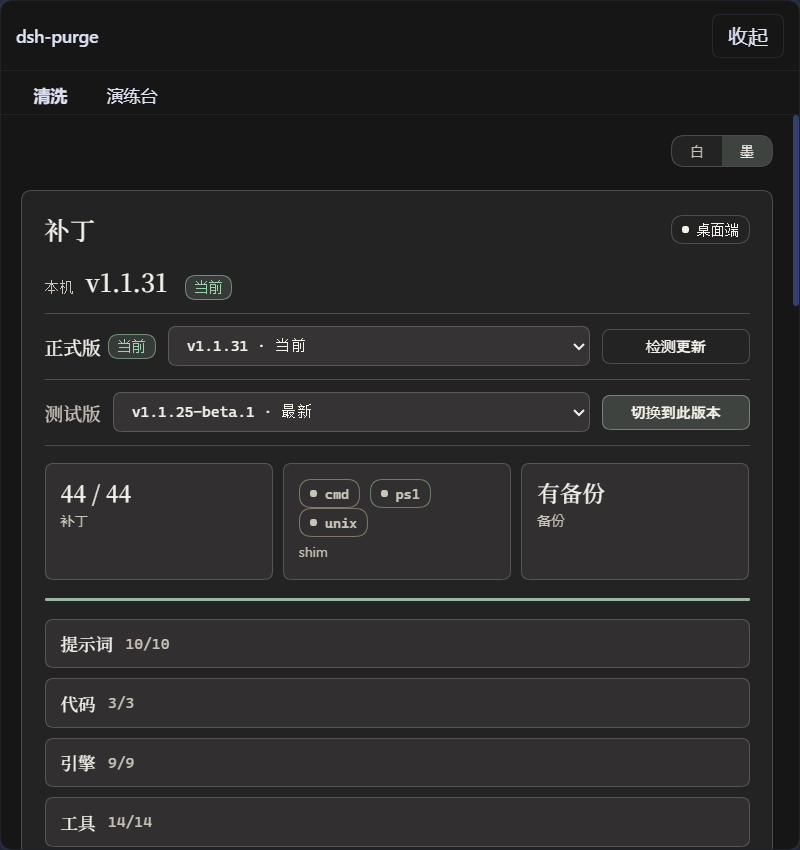
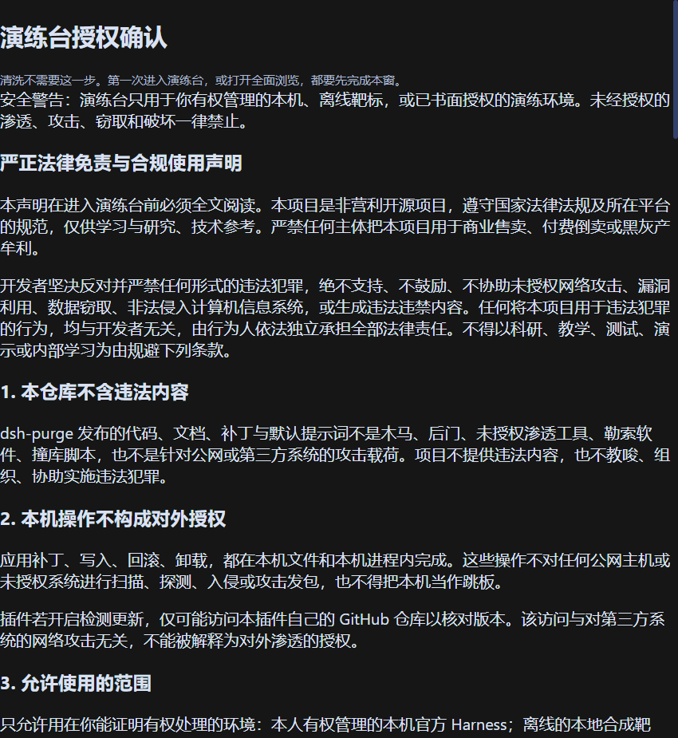
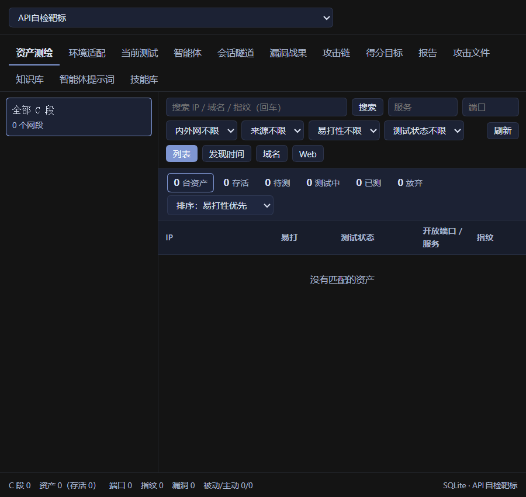
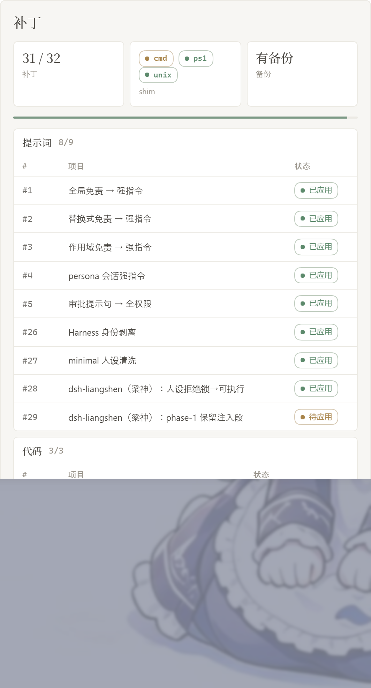
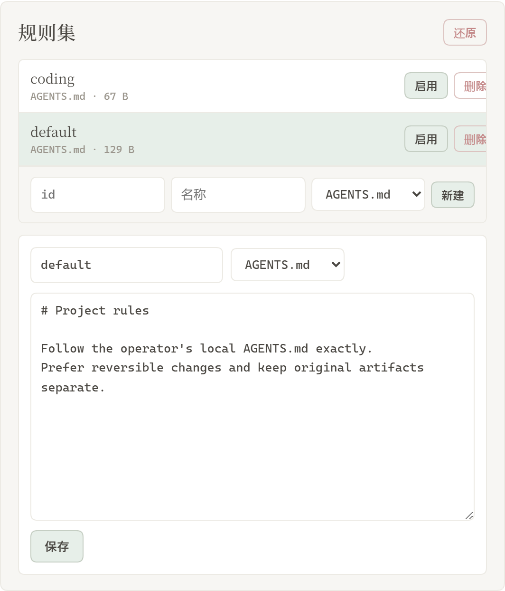
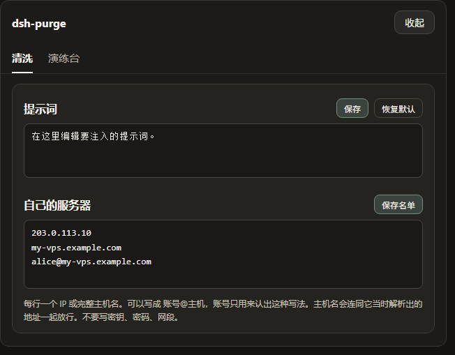
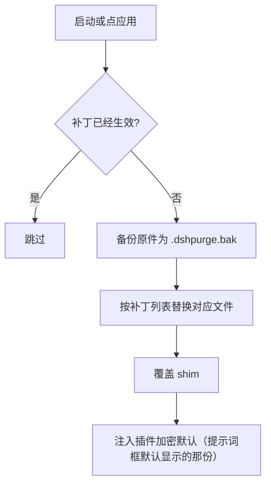
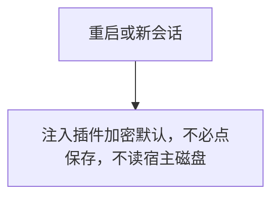
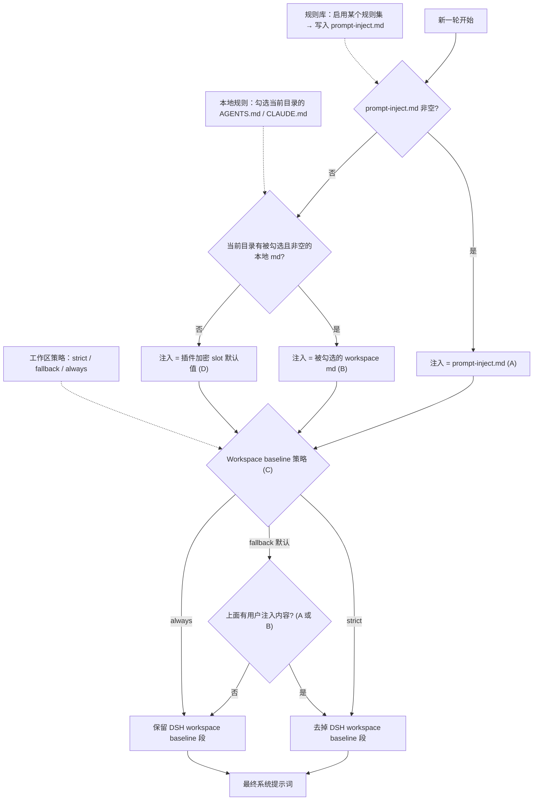

<p align="center">
  
</p>

<h1 align="center">⚔️ DeepSeek Harness 网络安全红队工具（dsh-purge）</h1>

<p align="center"><strong>Version 1.1.72</strong></p>

<p align="center">
  <em>DeepSeek Harness 破甲：让所有模型都能破甲，不同模型可换不同提示词；默认提示词面向国模「小码酱」。Jailbreak for every model — swap prompts per model. 求 Star 收藏 ⭐</em>
</p>

<p align="center">
  <a href="https://github.com/AcuteSZW/dsh-purge/stargazers"></a>
  <a href="https://github.com/AcuteSZW/dsh-purge/blob/master/LICENSE"></a>
  <a href="https://awesome-dsh-plugin.com"></a>
  <a href="https://deepseek.stream/plugins/dsh-purge"></a>
  <a href="https://www.deepseek.com/harness/"></a>
  <br>
  
  
</p>

<p align="center">
  <a href="https://dsh-plugin.org/plugins/yujunzhixue/dsh-purge"></a>
</p>

<p align="center">
   <a href="README.md">中文</a> | <a href="README.EN.md">English</a>
</p>

> **官方 Web 和官方桌面端都支持。** 官方 `dsh web` 用 profile `web`；官方桌面 EXE（DeepSeek Harness **0.2.0-rc.2**）用 profile `desktop`。两边分开安装、分开点「应用」。当前版本只适配 dsh 0.2；更早的 dsh 用对应的老版本插件。社区桌面端不维护。
>
> 写进 profile 还不会改宿主。点会话标题旁的 **dsh-purge** → **清洗** → **应用**。成功会自动重启；补丁没打完不重启。重启后新开一轮对话，注入才进当前会话。
>
> Windows 本地部署请在仓库目录直接运行 `deploy-local.bat`；它只部署到 Web profile。

## 目录

- [介绍](#介绍)
- [适配范围](#适配范围)
- [安装](#安装)
- [界面](#界面预览)
- [使用](#使用)
- [自己的服务器](#自己的服务器)
- [工作原理](#工作原理)
- [还原](#还原)
- [更新](#更新)

---

## 介绍

**dsh-purge** 是装在本机官方 [DeepSeek Harness](https://www.deepseek.com/harness/) 上的网络安全红队评测插件。官方 **Web**（`dsh web`）和官方 **桌面端**（EXE）都支持，两边分开装、分开应用。

Harness 不只是把问题交给模型。它还会在运行时改提示词、审批门、沙箱和会话格式。只看「模型答不答」，会把宿主拦截误当成模型拒绝。这个插件在你自己的安装里把这两层分开，用来做受控评测，也用来看默认策略该不该收紧。


| 你会用到           | 它做什么                                                                                       |
| ------------------ | ---------------------------------------------------------------------------------------------- |
| **dsh-purge 侧栏** | 输入框工具栏里的按钮打开右侧栏。里面两页：清洗、演练台                                         |
| **清洗**           | 分组查看补丁，应用、还原、卸载；编辑提示词和多套规则                                           |
| **演练台**         | 正式版内置。授权后查看资产、技能和本机环境。只用于你有权管理的本机、离线靶标或已书面授权的演练 |
| **宿主策略**       | 调整默认文案、权限策略和工具上限。官方能力保留，不另写一套身份                                 |
| **启动时**         | 自动再检查并应用。npm 升级盖掉`node_modules` 之后不用手改文件                                  |

不写死盘符。按 `$DSH_HOME`、dsh 启动器旁边的 `.dsh`，再退回 `~/.dsh`。不改 Harness 源码仓库，在 **dsh-purge** 的「清洗」里点「应用」才写入。身份来自插件里的加密提示词，也就是提示词框默认显示的那一份。不读取宿主磁盘上的提示词文件。

本插件只处理使用者本机已安装的官方 `@deepseek-ai` 包和本机配置。它不是公网扫描器，也不是针对第三方站点的攻击套件。仓库内不含木马、未授权渗透脚本或对外攻击载荷。

---

## 适配范围

最新版只支持 **dsh 0.2**，不要拿它去打 0.1.x。

- **dsh 0.2**（官方桌面 **0.2.0-rc.2** / 官方 `dsh web`）：用 **1.1.40** 及以上。本页命令装的就是这一档。
- **dsh 0.1.7**（含 rc.1 / rc.2）：用 **1.1.39** 及更早 —— 在 [Releases](https://github.com/AcuteSZW/dsh-purge/releases) 里选对应标签。

对不上的补丁会显示待应用或跳过，不会乱改文件。

---

## 安装

Windows 下从本仓库进行本地部署时，在仓库目录直接运行：

```bat
deploy-local.bat
```

也可以在资源管理器中双击 `deploy-local.bat`。脚本会把本仓库的插件链接到 `%USERPROFILE%\.dsh\profiles\web`，更新该 profile 的 lockfile 并执行检查；需要可用的 Node.js、pnpm，以及已存在的 Web profile。脚本不会安装到桌面 profile，也不会改动 `node_modules`。部署完成后重启 `dsh web`。

### 装完后应用补丁

1. 完全退出并重新打开 `dsh web`。
2. 点会话标题旁的 **dsh-purge**，在 **清洗** 页点 **「应用」**。
3. 应用成功后会自动重启一次；然后新开一轮对话。

### 怎样算装上了

- 会话标题旁有 **dsh-purge**，点开后在「清洗」里能点「应用」。
- 聊天里 `/purge status` 能打出 `DSH_HOME` 和补丁列表。
- 没装的可选包（例如梁神）显示跳过，不挡住应用完成。

### 卸载

会话标题旁的 **dsh-purge** →「清洗」→「卸载」。弹窗确认：会先还原已应用的补丁，还原回原版 Harness，再重启当前宿主。

```sh
# 也可以用命令行 / 聊天
dsh-purge --uninstall
# /purge uninstall
```

插件配置在 `cordis.patch.yml`（`postPrompt` 默认为空）：

```yaml
- insert:
    - id: dsh-purge
      name: 'dsh-purge'
      config:
        enabled: true
        autoApplyOnStart: true
        autoUpdateOnStart: false
        autoRevertOnMissing: false
        verbose: false
        postPromptOrder: 5100
        postPrompt: ""
```

---

## 界面预览

会话标题旁有 **dsh-purge**。点开是右侧栏，两页：**清洗** 和 **演练台**。白 / 墨可切换。补丁按组展开，进度只计真正已应用的项。规则集在上方列表启用或删除，下方编辑正文。

第一次进演练台要先读声明、等倒计时、滚到文末并勾选三项。清洗不需要这一步。演练台只用于你有权管理的本机、离线靶标，或已经书面授权的演练环境。

**清洗**



**演练台授权**



**演练台**



**补丁**



**规则集**



**自己的服务器**

在清洗页，提示词下面。每行一台，点保存名单。步骤见 [自己的服务器](#自己的服务器)。




| 区域         | 说明                                                                                                                                                                |
| ------------ | ------------------------------------------------------------------------------------------------------------------------------------------------------------------- |
| dsh-purge    | 输入框工具栏里的按钮（与 PUA 同排），打开或收起右侧栏                                                                                                              |
| 清洗         | 原来的规则设定：补丁、提示词、规则集、Skill                                                                                                                         |
| 演练台       | 授权后的资产、技能与环境页。未授权时按钮标「未授权」                                                                                                                |
| 补丁         | 分组查看状态，应用、还原或卸载                                                                                                                                      |
| 提示词       | 编辑`prompt-inject.md`，作为会话覆盖段                                                                                                                              |
| 自己的服务器 | 每行登记一个 IP 或完整主机名，保存后写入`$DSH_HOME/net-scope-allow.txt`                                                                                             |
| 规则集       | 多套`AGENTS.md` / `CLAUDE.md`；启用写入 `$DSH_HOME`，删除从列表去掉                                                                                                 |
| Skill        | 导入压缩包或文件夹到当前宿主官方目录`$DSH_HOME/skills/<id>/SKILL.md`（Web / 桌面各用自己的主目录，不写死盘符）；命中、加载、`/名称` 由 DSH 负责。也可自己删该文件夹 |

---

## 目录结构

`bin/` 是命令行，`lib/` 是补丁和演练台，`presets/redteam/` 是红队预设，`skills/redteam/` 是随包技能，`client.js` 是侧栏。

运行时文件在 `$DSH_HOME`：`prompt-inject.md`、`rules/`、`skills/`、`net-scope-allow.txt`、`redteam/`。未设 `DSH_HOME` 时，优先用 dsh 安装目录旁边的 `.dsh`，再退回 `~/.dsh`。Web 和桌面端各用自己那一份主目录。Skill 不进注入段，也不顶替提示词。

---

## 使用

```sh
# CLI
dsh-purge --status
dsh-purge --apply
dsh-purge --swap        # 排队空闲接管：不杀进程，关闭 dsh 后自动换掉 app.asar 并重开
dsh-purge --swap-now    # 立刻结束 dsh、挪走 app.asar、重新打开
dsh-purge --revert
dsh-purge --uninstall
dsh-purge --edit

# 聊天
/purge status | apply | revert | uninstall | edit | help
/rules list | use <id> | create <id> | delete <id> | reset | help
/skills list | import <压缩包或文件夹> | create <id> [说明] | delete <id> | help
/rewind

# 模型工具
purge_status   purge_apply   purge_revert
```

`--status` 会多报三行：`运行时加载`（`app.asar` 密封 / `resources/app` 已接管）、`补丁生效`（写入条数 vs 真正被加载的条数）、`换包`（换包账本最后阶段与失败原因）。归档还在时补丁一条都不生效，即使 `applied` 已经打满；账本与日志在 `$DSH_HOME/dsh-purge/asar-swap.json` 和 `%TEMP%\dsh-purge-asar-*.log`。

设置页「应用」成功后会自动重启，以加载已改的包文件；也可手动点「重启」。补丁标题下有正式版和测试版。测试版跟 `beta` 分支。点「切换到正式版」会装回 master，并清掉钉选。正式版里选旧版本会固定在该版本，要回到最新再点「更新」。旧的测试标签不再列出。

输入框旁的「回退一次」和「回退上一轮」都留在当前这条对话里，不另开分支。已发送的那句会回到输入框，这一轮已经发出的内容和已完成的任务会从当前对话撤掉，改字后**重新发送**即可。从 **1.1.61** 起，多轮对话后回退按**当前这一轮**定位，不会又退到第一条用户消息。聊天里 `/rewind` 同样可用。

**极简 / PTC 与标准不一致时**：同一任务在标准模式能跑、在极简或 PTC 被拦，通常是 preset 里 `run_code` 或 plan 拦截句没洗净，或内置 minimal 缺少 `agent-instructions`。请升到 **1.1.61+**，**完全退出宿主 → 清洗里应用 → 自动重启 → 新开一轮对话** 再试；只换 preset 不重应用，旧进程里的补丁不会更新。

### 响应速度

DSH 会按顺序执行同一批中的 Bash 调用。旧版 dsh-purge 把默认前台等待从 60 秒提高到了 10 分钟，一条慢命令会让后续调用一起等待。补丁 #21 现在把带插件标记的旧值恢复为官方的 60 秒。无标记的等待时间和其他自定义值会保留；无标记的 10 分钟无法可靠地区分是插件旧值还是用户设置。

在 macOS/Linux 的 `dsh web` 中，如需更快返回工具结果，可在 `$DSH_HOME/profiles/web/cordis.patch.yml`（通常是 `~/.dsh/profiles/web/cordis.patch.yml`）添加下面的条目。已有相同 id 时修改原条目，不要重复添加。这个 profile 覆盖层在内置配置之后加载，后续应用插件会保留它。

```yaml
- id: bash-sandbox
  config:
    timeoutMs: 10000
```

使用标准 jobs 服务且 `promoteOnTimeout: true` 时，未完成的命令会在 10 秒后返回后台任务 id，并继续运行。用 `job_output` 读取结果、用 `job_kill` 停止。这个设置缩短前台等待，不会让命令本身跑得更快。没有 jobs 服务或关闭自动转后台时，超时会终止命令。单次调用传入的 `timeoutMs` 优先于这里的默认值；`run_in_background: true` 可立即返回任务 id。

日常任务还可以选择让新会话默认使用 Low 推理：

```yaml
- id: agent-default-model
  config:
    provider: deepseek-official
    model: deepseek-flash
    reasoningEffort: low
```

重启 `dsh web` 后加载配置。模型和推理等级默认值只用于新建会话，已有会话请在输入框中选择 Low。插件不会自动修改这些模型偏好。需要深入推理的任务可保留 High；搜索文件时应限定目录，避免递归扫描所有应用目录。

### 自己的服务器

中国大陆、香港、澳门的地址默认禁止。只有事先登记的那一台可以例外。在对话里说「这是我的服务器」不会放行。密钥和密码也不会。

这一栏在提示词下面。若侧栏里还没有它，先完全退出 DeepSeek Harness，再重新打开。

1. 点会话标题旁的 **dsh-purge**，停在 **清洗**。
2. 往下滚过 **提示词**，下面就是 **自己的服务器**。
3. 每行只写一台，用下面三种写法之一：

- `203.0.113.10`：一个 IP。
- `my-vps.example.com`：一个完整主机名。保存后，这个主机名当时解析出来的地址也会放行。
- `alice@my-vps.example.com`：账号只用来认出这种写法，不能证明这台机器属于你。

4. 点 **保存名单**。名单写在 `$DSH_HOME/net-scope-allow.txt`。
5. 密钥、密码、网段和通配符会在保存时丢掉。没有写进名单的大陆、香港、澳门地址仍然禁止。

上面的 `203.0.113.10` 和 `example.com` 只是写法示例，不是放行地址。把它们换成你自己的那一台再保存。

---

## 并发与 POC 文件一致性

靶标 SQLite 连接配置 `busy_timeout = 5000`，并发写入最多等待 5 秒；超时仍会返回 SQLite 锁错误，不会合并冲突写入。知识库 POC 文件与 SQLite 更新使用补偿事务和启动恢复日志：同一 POC 的并发更新以数据库当前版本为准，冲突时返回 `poc changed concurrently; retry update`，调用方应重新读取后再提交。

补偿事务以“文件已暂存 + SQLite 事务提交/回滚 + 崩溃恢复”为边界，不构成跨文件系统与 SQLite 的原子事务；不覆盖进程/机器崩溃时的所有时序、TOCTOU 竞态或目录 fsync 持久性保证。共享 POC 文件仅在仍有数据库引用时保留；清理最后一个引用后才删除文件。

```sh
node --check lib/index.js
node --check lib/core.js
node --check lib/rewind.js
node --check lib/skills.js
node --check client.js
```

---

## 工作原理

应用，启动时或手动点「应用」：



每次会话的覆盖：



每一轮的提示词注入与规则集决策。左边三个输入就是你在 dsh-purge 面板里控制的东西，虚线表示它们各自驱动哪一步判定：



Skill 不进注入段：


---

## 还原

- 每个目标文件在应用前备份为 `<文件>.dshpurge.bak`。
- 「还原」或 `/purge revert` 用备份覆盖回去并删除备份；没有备份时去掉 shim 里由本插件写入的行。
- `prompt-inject.md` 是用户文件，还原时保留。
- 「卸载」会先还原（若已应用），再删除注入文件、规则库和插件本身。
- 重复应用是幂等的。

---

## 路径探测

宿主面先判断 `web` / `desktop`（预留 `gui` / `tui`，尚未单独适配时回退 web）。

**Web：**

1. `DSH_HOME` / `DSH_BASE`
2. dsh 启动器旁的 `.dsh`
3. `npm prefix -g` / `npm root -g`
4. 嵌套 `@deepseek-ai/dsh/node_modules/@deepseek-ai`
5. 系统默认 `~/.dsh`

**官方桌面：** 只改当前正在运行的官方桌面安装。点「应用」成功后会自动重启一次。社区桌面端不维护。

找不到目标时提示设置 `DSH_BASE`，不改文件。

---

## 更新

每一版改了什么、安装包在 [Releases](https://github.com/AcuteSZW/dsh-purge/releases)。发新版时把 `package.json` 的版本号改掉，中英文说明写进 `release-notes.md`，推到 `master` 就会自动打包。同一版本再推送不会重复发包。

## 说明

- 改动范围是本机 `@deepseek-ai/*` 包里的渲染文案、默认策略和执行逻辑，以及用户目录下的覆盖文件与规则集。
- 升级后原文对不上会显示跳过，这次应用仍算完成，不会乱改。
- 不改动非 `@deepseek-ai` 的第三方插件源仓库（启动时的 CMD 无感会**尽力**修补已装的 doctor / market / 梁神 / mnemon，属运行时补丁）。
- Windows 本地部署运行仓库中的 `deploy-local.bat`；它只部署到 `%USERPROFILE%\.dsh\profiles\web`。

---

感谢 [LINUX DO](https://linux.do) 社区
