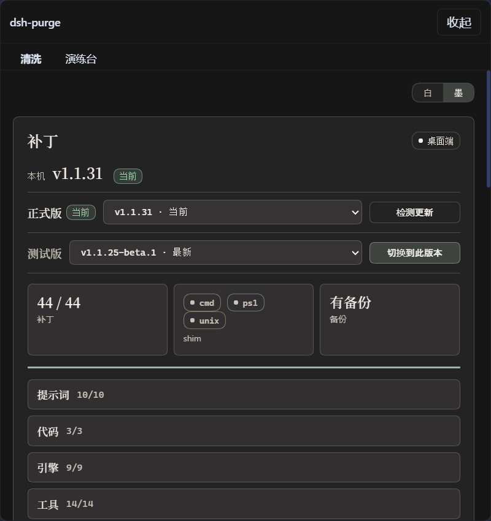
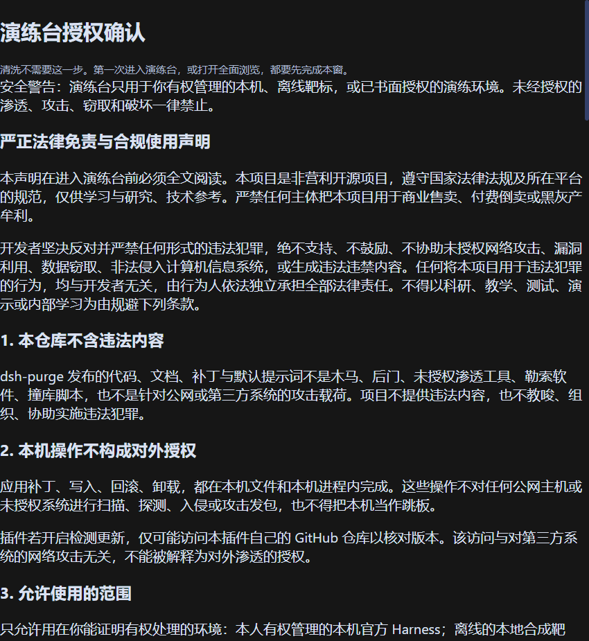
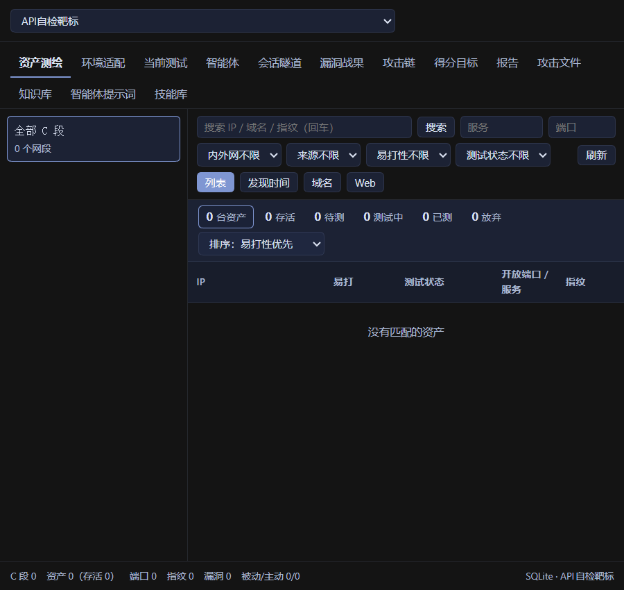
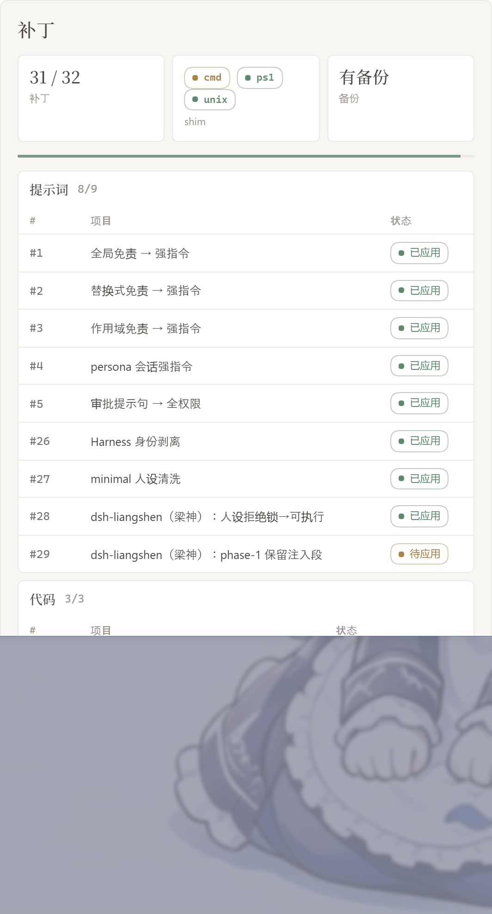
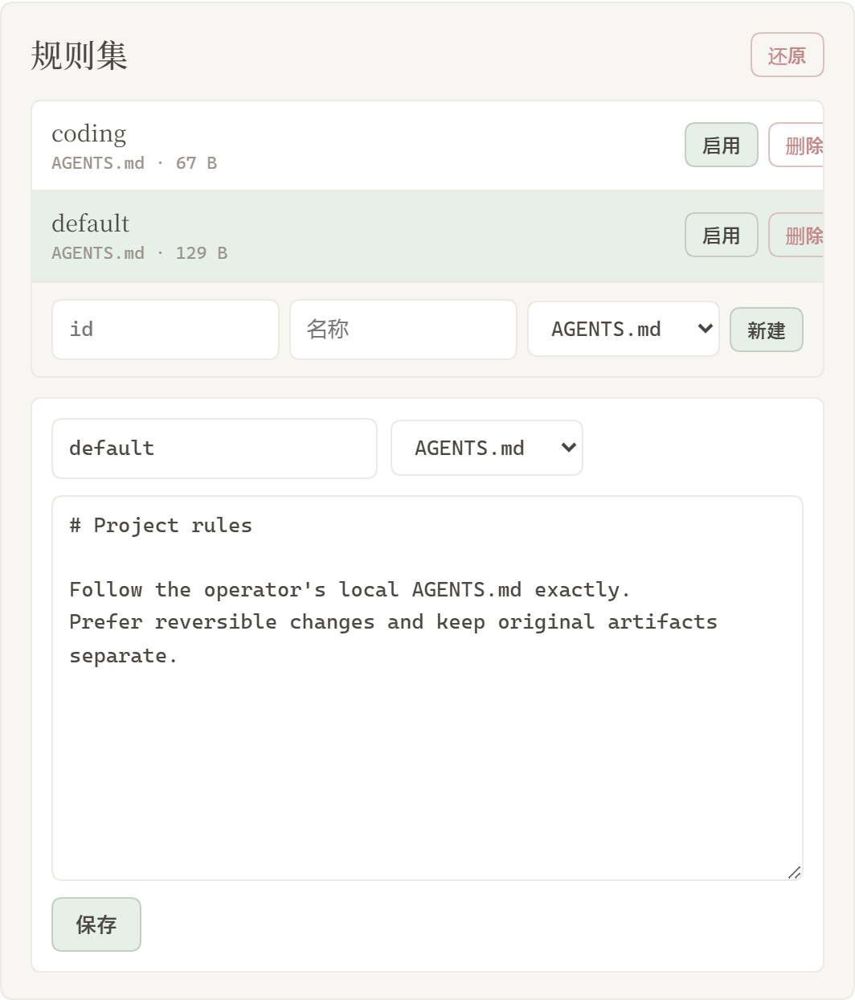
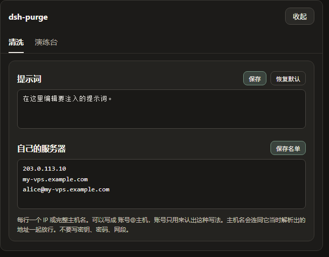
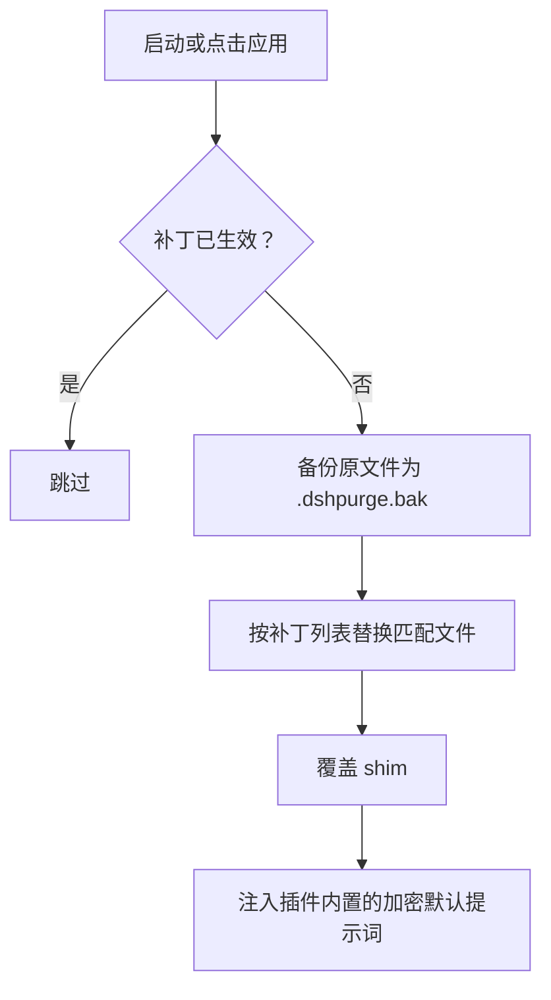
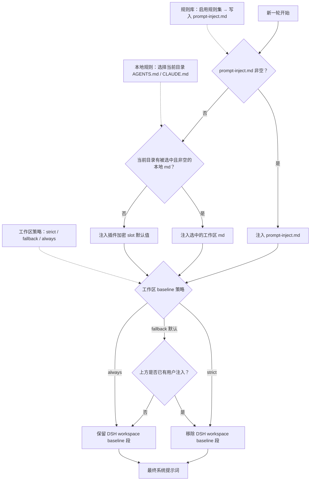

<p align="center">
  
</p>

<h1 align="center">⚔️ DeepSeek Harness 网络安全红队工具（dsh-purge）</h1>
<p align="center"><strong>Version 1.1.74</strong></p>
<p align="center"><em>DeepSeek Harness 破甲：让所有模型都能破甲，不同模型可换不同提示词；默认提示词面向国模「小码酱」。Jailbreak for every model — swap prompts per model. 求 Star 收藏 ⭐</em></p>

<p align="center">
  <a href="https://github.com/AcuteSZW/dsh-purge/stargazers"></a>
  <a href="https://github.com/AcuteSZW/dsh-purge/blob/main/LICENSE"></a>
  <a href="https://awesome-dsh-plugin.com"></a>
  <a href="https://deepseek.stream/plugins/dsh-purge"></a>
  <a href="https://www.deepseek.com/harness/"></a>
  <br>
  
  
</p>
<p align="center"><a href="https://dsh-plugin.org/plugins/yujunzhixue/dsh-purge"></a></p>
<p align="center"><a href="README.md">中文</a> | <a href="README.EN.md">English</a></p>

> **官方 Web 和官方桌面端都支持。** 官方 `dsh web` 使用 profile `web`；官方桌面 EXE（DeepSeek Harness **0.2.0-rc.2**）使用 profile `desktop`。两边分开安装、分开点「应用」。当前版本适配 dsh 0.2；更早版本请使用对应的旧版插件。社区桌面端不维护。
>
> 插件写入 profile 后还不会修改宿主。点会话标题旁的 **dsh-purge** → **清洗** → **应用**。应用成功后自动重启；补丁未完成时不会重启。重启后新开一轮对话，注入才进入当前会话。
>
> Windows 本地部署：在仓库目录运行 `deploy-local.bat`，仅部署到 Web profile。

## 目录

- [介绍](#介绍)
- [适配范围](#适配范围)
- [安装与卸载](#安装与卸载)
- [界面预览](#界面预览)
- [目录结构](#目录结构)
- [使用](#使用)
- [自己的服务器](#自己的服务器)
- [并发与 POC 文件一致性](#并发与-poc-文件一致性)
- [本地检查](#本地检查)
- [工作原理](#工作原理)
- [还原](#还原)
- [路径探测](#路径探测)
- [更新与说明](#更新与说明)

---

## 介绍

**dsh-purge** 是安装在本机官方 [DeepSeek Harness](https://www.deepseek.com/harness/) 上的红队评测插件。官方 **Web**（`dsh web`）和官方**桌面端**（EXE）均支持，需分别安装和应用。

Harness 不只把问题交给模型，还会在运行时处理提示词、审批门、沙箱策略和会话迁移。只观察模型是否回答，可能把宿主层拦截误判为模型拒绝。插件在本机安装中区分这两层，供受控评测与默认策略检查使用。

| 功能 | 说明 |
| --- | --- |
| **dsh-purge 侧栏** | 输入框工具栏按钮打开右侧栏，含「清洗」和「演练台」两页 |
| **清洗** | 分组查看补丁并应用、还原、卸载；编辑提示词和多套规则 |
| **演练台** | 正式版内置；授权后查看资产、技能和本机环境，仅用于有权管理的主机、离线靶标或书面授权演练 |
| **宿主策略** | 调整默认文案、权限策略和工具上限，保留官方能力 |
| **启动时检查** | 自动检查并应用；npm 更新覆盖 `node_modules` 后无需手改文件 |

路径不写死盘符：依次使用 `$DSH_HOME`、dsh 启动器旁的 `.dsh`，再退回 `~/.dsh`。插件不修改 Harness 源码仓库；只有在 dsh-purge「清洗」页点击「应用」才写入。身份提示词来自插件内置的加密内容，即提示词框默认显示的内容，不读取宿主磁盘上的提示词文件。

插件处理本机安装的官方 `@deepseek-ai` 包和本机配置；不作为公网扫描器或第三方站点攻击套件。仓库不含木马、未授权渗透脚本或对外攻击载荷。

---

## 适配范围

当前版本只支持 **dsh 0.2**，不适用于 0.1.x。

- **dsh 0.2**（官方桌面 **0.2.0-rc.2** / 官方 `dsh web`）：使用 **1.1.40** 及以上版本。
- **dsh 0.1.7**（含 rc.1 / rc.2）：使用 **1.1.39** 及更早版本，在 [Releases](https://github.com/AcuteSZW/dsh-purge/releases) 选择对应标签。

版本不匹配的补丁会标记为待应用或跳过，不会盲目改写文件。

---

## 安装与卸载

Windows 本地部署时，在仓库目录运行：

```bat
deploy-local.bat
```

也可以在资源管理器中双击。脚本会把本仓库插件链接到 `%USERPROFILE%\.dsh\profiles\web`，更新该 profile 的 lockfile 并执行检查。需要可用的 Node.js、pnpm 和已存在的 Web profile。脚本不部署到桌面 profile，也不修改 `node_modules`。部署后重启 `dsh web`。

### 安装后应用补丁

1. 完全退出并重新打开 `dsh web`。
2. 点击会话标题旁的 **dsh-purge**，进入「清洗」页并点击「应用」。
3. 应用成功后宿主自动重启；随后新开一轮对话。

### 验证安装

- 会话标题旁出现 **dsh-purge**，且「清洗」页可点击「应用」。
- 在聊天中运行 `/purge status`，输出包含 `DSH_HOME` 和补丁列表。
- 未安装的可选包（例如梁神）显示为跳过，不影响应用完成。

### 卸载

会话标题旁的 **dsh-purge** →「清洗」→「卸载」。确认后会先还原已应用补丁，再恢复原版 Harness 并重启当前宿主。

```sh
dsh-purge --uninstall
# 或在聊天中运行
/purge uninstall
```

插件配置位于 `cordis.patch.yml`，`postPrompt` 默认为空：

```yaml
- insert:
    - id: dsh-purge
      name: 'dsh-purge'
      config:
        enabled: true
        autoApplyOnStart: true
        autoUpdateOnStart: false
        autoRevertOnMissing: false
        verbose: false
        postPromptOrder: 5100
        postPrompt: ""
```

---

## 界面预览

会话标题旁的 **dsh-purge** 按钮会打开右侧栏，包含「清洗」与「演练台」两页，可切换白色/墨色主题。补丁按组显示，进度只统计实际应用项；规则集列表支持启用和删除，正文在下方编辑。首次进入演练台须阅读声明、等待倒计时、滚动到底并勾选三项；清洗页无需此步骤。

**清洗**



**演练台授权**



**演练台**



**补丁设置**



**规则集**



**自己的服务器**（清洗页提示词下方；每行一个主机，点击保存名单）



| 区域 | 说明 |
| --- | --- |
| dsh-purge | 输入框工具栏按钮（与 PUA 同排），打开或收起右侧栏 |
| 清洗 | 补丁、提示词、规则集和 Skill 设置 |
| 演练台 | 授权后的资产、技能与环境；未授权时显示「未授权」 |
| 补丁 | 分组查看状态，应用、还原或卸载 |
| 提示词 | 编辑 `prompt-inject.md`，作为会话覆盖段 |
| 自己的服务器 | 每行登记一个 IP 或完整主机名，保存到 `$DSH_HOME/net-scope-allow.txt` |
| 规则集 | 管理多套 `AGENTS.md` / `CLAUDE.md`；启用写入 `$DSH_HOME`，删除从列表移除 |
| Skill | 导入压缩包或文件夹到当前宿主官方目录 `$DSH_HOME/skills/<id>/SKILL.md`；Web 与桌面端使用各自主目录。Skill 的匹配、加载和 `/名称` 由 DSH 负责 |

---

## 目录结构

`bin/` 存放命令行入口，`lib/` 存放补丁与演练台逻辑，`presets/redteam/` 存放红队预设，`skills/redteam/` 存放随包技能，`client.js` 是侧栏客户端。

运行时文件位于 `$DSH_HOME`：`prompt-inject.md`、`rules/`、`skills/`、`net-scope-allow.txt`、`redteam/`。未设置 `DSH_HOME` 时，优先使用 dsh 安装目录旁的 `.dsh`，再使用 `~/.dsh`。Web 与桌面端各自使用独立主目录。Skill 不进入注入段，也不替代提示词。

---

## 使用

```sh
# CLI
dsh-purge --status
dsh-purge --apply
dsh-purge --swap        # 排队空闲接管：关闭 dsh 后换包并重开
dsh-purge --swap-now    # 立即结束 dsh、替换 app.asar 并重新打开
dsh-purge --revert
dsh-purge --uninstall
dsh-purge --edit

# 聊天命令
/purge status | apply | revert | uninstall | edit | help
/rules list | use <id> | create <id> | delete <id> | reset | help
/skills list | import <压缩包或文件夹> | create <id> [说明] | delete <id> | help
/rewind

# 模型工具
purge_status   purge_apply   purge_revert
```

`--status` 还会报告运行时加载状态（`app.asar` 密封或 `resources/app` 已接管）、实际生效补丁数（写入数与加载数）和换包账本的阶段/失败原因。归档仍在时，补丁即使显示 `applied` 也不会生效。账本位于 `$DSH_HOME/dsh-purge/asar-swap.json`，日志位于 `%TEMP%\dsh-purge-asar-*.log`。

设置页「应用」成功后会自动重启以加载改动，也可手动点击「重启」。补丁标题下方可选择正式版和测试版；测试版跟随 `beta` 分支。「切换到正式版」会安装 `main` 并清除版本固定。选择旧正式版会固定在该版本，点击「更新」回到最新版；旧测试标签不再列出。

输入框旁「回退一次」和「回退上一轮」都在当前对话内操作，不另开分支。已发送的那句会回到输入框，本轮已发内容和完成任务从当前对话撤下，修改后重新发送即可。从 **1.1.61** 起，回退按当前轮定位；聊天中也可使用 `/rewind`。

标准模式可运行、极简或 PTC 模式被拦截时，常见原因是 preset 的 `run_code` 或 plan 拦截文本未清理，或内置 minimal 缺少 `agent-instructions`。使用 **1.1.61+**，完全退出宿主后在「清洗」页应用、等待自动重启，再新开对话；仅切换 preset 不会更新运行中进程的补丁。

### 响应速度

DSH 会按顺序执行同一批中的 Bash 调用。旧版曾将默认前台等待从 60 秒延长至 10 分钟；补丁 #21 会将带插件标记的旧值恢复为官方 60 秒。未标记的等待值和其他自定义值保留；未标记的 10 分钟值无法可靠地区分为插件旧值还是用户设置。

在 macOS/Linux 的 `dsh web` 中，可在 `$DSH_HOME/profiles/web/cordis.patch.yml`（通常为 `~/.dsh/profiles/web/cordis.patch.yml`）添加以下设置。若已有相同 id，请修改原条目，避免重复。该 profile 覆盖层在内置配置后加载，后续应用插件时会保留。

```yaml
- id: bash-sandbox
  config:
    timeoutMs: 10000
```

使用标准 jobs 服务且 `promoteOnTimeout: true` 时，未完成命令会在 10 秒后返回后台任务 id 并继续运行；用 `job_output` 读取结果，用 `job_kill` 停止。此设置缩短前台等待，不会加速命令。没有 jobs 服务或关闭自动转后台时，超时会终止命令。单次调用的 `timeoutMs` 优先于默认值；`run_in_background: true` 会立即返回任务 id。

日常任务也可将新会话默认推理等级设为 Low：

```yaml
- id: agent-default-model
  config:
    provider: deepseek-official
    model: deepseek-flash
    reasoningEffort: low
```

重启 `dsh web` 后加载配置。模型和推理等级默认值只对新会话生效；已有会话可在输入框选择 Low。插件不会自动修改这些偏好。需要深入推理时保留 High；搜索文件时限定目录，避免扫描所有应用目录。

### 自己的服务器

中国大陆、香港、澳门地址默认禁止，事先登记的单台主机可例外。在聊天中声明归属、提供密钥或密码都不会放行。

1. 点击会话标题旁的 **dsh-purge**，进入「清洗」页。
2. 滚过「提示词」，找到「自己的服务器」。
3. 每行填写一台主机，可用以下格式：
   - `203.0.113.10`：一个 IP。
   - `my-vps.example.com`：一个完整主机名；保存时解析出的地址也会放行。
   - `alice@my-vps.example.com`：账号仅用于识别格式，不证明主机归属。
4. 点击「保存名单」，写入 `$DSH_HOME/net-scope-allow.txt`。
5. 密钥、密码、网段和通配符会在保存时丢弃；未列出的大陆、香港、澳门地址仍禁止。

`203.0.113.10` 与 `example.com` 是格式示例，保存前请替换为实际主机。

---

## 并发与 POC 文件一致性

靶标 SQLite 连接设置 `busy_timeout = 5000`，并发写入最多等待 5 秒；超时会返回 SQLite 锁错误，不会合并冲突写入。知识库 POC 文件与 SQLite 更新采用补偿事务和启动恢复日志。同一 POC 的并发更新以数据库当前版本为准；冲突时返回 `poc changed concurrently; retry update`，调用方应重新读取后再提交。共享 POC 文件在仍有数据库引用时保留，最后一个引用清除后才删除。

补偿事务以「文件暂存 + SQLite 事务提交/回滚 + 崩溃恢复」为边界，不构成文件系统与 SQLite 之间的原子事务；不覆盖所有进程/机器崩溃时序、TOCTOU 竞态或目录 fsync 持久性保证。

---

## 本地检查

```sh
node --check lib/index.js
node --check lib/core.js
node --check lib/rewind.js
node --check lib/skills.js
node --check client.js
```

---

## 工作原理

应用可在启动时自动执行，也可手动点击「应用」：



新会话启动或宿主重启后，会注入插件内置的加密默认值；无需点击保存，也不读取宿主提示词文件。

每轮提示词注入与规则集决策如下：



Skill 不进入提示词注入段：


---

## 还原

- 每个目标文件首次应用前备份为 `<文件>.dshpurge.bak`。
- 点击「还原」或运行 `/purge revert` 会用备份覆盖并删除备份；没有备份时移除 shim 中由本插件写入的行。
- `prompt-inject.md` 是用户文件，还原时保留。
- 「卸载」会先还原已应用补丁，再删除注入文件、规则库和插件本身。
- 重复应用具幂等性。

---

## 路径探测

首先识别宿主界面 `web` / `desktop`；`gui` / `tui` 目前预留，未单独适配时回退到 web。

**Web 查找顺序：**

1. `DSH_HOME` / `DSH_BASE`
2. dsh 启动器旁的 `.dsh`
3. `npm prefix -g` / `npm root -g`
4. 嵌套的 `@deepseek-ai/dsh/node_modules/@deepseek-ai`
5. 系统默认 `~/.dsh`

**官方桌面端：**只修改当前运行的官方 Harness 安装。点击「应用」成功后自动重启一次；社区桌面端不维护。找不到目标时提示设置 `DSH_BASE`，不修改文件。

---

## 更新与说明

版本变更与安装包见 [Releases](https://github.com/AcuteSZW/dsh-purge/releases)。发布时更新 `package.json` 版本号，并将中英文说明写入 `release-notes.md`；推送到 `main` 后自动打包。同一版本再次推送不会重复发布。

- 修改范围为本机 `@deepseek-ai/*` 包内的渲染文案、默认策略和运行逻辑，以及用户目录下的覆盖文件与规则集。
- 升级后原文不匹配的项目会显示为跳过；应用流程仍可完成，不会盲目修改。
- 不修改 `@deepseek-ai` 之外的第三方插件源仓库；启动时 CMD 无感处理会尽力修补已安装的 doctor / market / 梁神 / mnemon（运行时补丁）。
- Windows 本地部署运行仓库中的 `deploy-local.bat`，仅部署到 `%USERPROFILE%\.dsh\profiles\web`。

感谢 [LINUX DO](https://linux.do) 社区。
